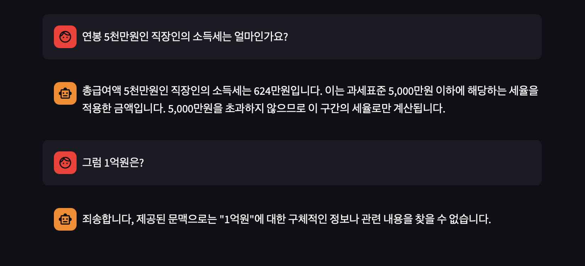
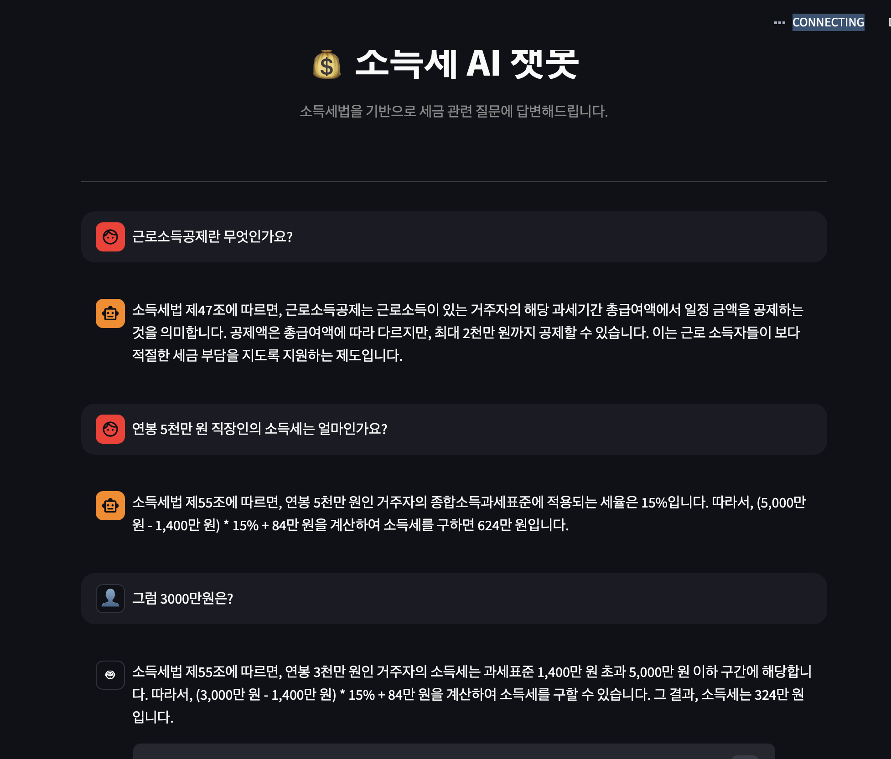

# 소득세법 AI 챗봇

한국 소득세법 문서에서 질문과 관련된 조항을 검색하고, 검색한 내용을 바탕으로 답변을 생성하는 RAG 학습 프로젝트입니다. Chroma로 문서 검색을 실험한 뒤 Pinecone을 연결하고, 앞선 대화를 활용해 후속 질문을 처리하는 챗봇을 구현했습니다.

## 문제 해결

### 1. Word 문서의 세율표를 검색에 포함하기

원본 Word 문서를 `Docx2txtLoader`로 읽었을 때 세율표가 추출되지 않아, 검색 결과에 과세표준 구간과 해당 세율의 관계가 빠졌습니다. 표를 Markdown 텍스트로 변환해 `tax_with_markdown.docx`에 담았습니다. 전처리한 문서를 `Docx2txtLoader`로 읽고 `RecursiveCharacterTextSplitter`로 분할한 뒤 임베딩했습니다. 두 검색 실험 코드는 청크 크기 1,500자와 중첩 200자를 사용합니다.

### 2. 앞선 대화를 반영해 후속 질문 검색하기

#### 문제: 화면에 대화가 보여도 검색은 앞선 질문을 이해하지 못함

첫 질문인 **“연봉 5천만 원인 직장인의 소득세는 얼마인가요?”**에는 답했지만, 이어서 **“그럼 1억 원은?”**이라고 물으면 “제공된 문맥으로는 관련 내용을 찾을 수 없다”고 응답했습니다. 사용자는 같은 연봉·소득세 주제의 질문을 이어갔지만, 짧은 후속 질문에는 검색에 필요한 대상과 조건이 생략되어 있었습니다.

**개선 전 — 후속 질문의 맥락을 놓친 화면**



#### 원인과 접근: 답변뿐 아니라 검색 단계에도 대화 기록을 연결

[chat.py](chat.py)의 `st.session_state.message_list`는 이전 메시지를 화면에 다시 보여 주기 위한 기록입니다. 화면에 대화가 남아 있는 것만으로 그 기록이 검색 체인에 전달되는 것은 아닙니다. 후속 질문을 처리하려면 **대화 기록 저장 → 검색 질문 재작성 → 관련 조항 검색 → 답변 생성**의 연결이 필요했습니다.

[llm.py](llm.py)에서는 다음과 같이 구성했습니다.

1. **대화 기록 저장:** `get_session_history(session_id)`가 세션별 `ChatMessageHistory`를 반환하고, `RunnableWithMessageHistory`가 입력과 답변을 기록합니다. `input`, `chat_history`, `answer` 키를 지정해 체인과 연결했습니다.
2. **독립적인 검색 질문으로 재작성:** `get_history_retriever()`의 프롬프트에 `MessagesPlaceholder("chat_history")`와 최신 질문을 함께 넣었습니다. `create_history_aware_retriever`가 앞선 대화로 생략된 대상을 보완한 뒤 검색합니다.
3. **검색 근거와 대화를 함께 사용:** Pinecone에서 관련 청크 4개를 가져오고, 답변 프롬프트에도 대화 기록을 전달합니다. 답변은 `get_ai_response()`에서 스트리밍해 화면에 표시합니다.

예를 들어, “그럼 3천만 원은?”을 앞선 연봉 질문과 연결해 “연봉 3천만 원인 직장인의 소득세는 얼마인가요?”처럼 독립적으로 이해할 수 있는 질문으로 바꾸도록 설계했습니다.

#### 확인 결과: 생략된 질문을 같은 주제의 후속 질문으로 처리

**개선 후 — “그럼 3000만원은?”을 직전 연봉 질문과 연결한 화면**



개선 후 화면에서는 근로소득공제와 연봉 5천만 원에 관한 대화 뒤에 “그럼 3000만원은?”이라고 물었을 때, 이를 직전 연봉 질문의 연장으로 받아들이고 소득세법 제55조를 언급하며 답변을 이어갔습니다.

| 확인 항목 | 개선 전 화면 | 개선 후 화면 |
| --- | --- | --- |
| 후속 질문 | “그럼 1억원은?” | “그럼 3000만원은?” |
| 관찰된 응답 | 금액의 맥락을 놓치고 관련 정보를 찾지 못함 | 연봉·소득세 주제로 연결해 답변을 이어감 |
| 이 사례에서 확인한 점 | 후속 질문만으로는 검색 대상이 불분명할 수 있음 | 대화 기록을 활용하는 검색·답변 흐름의 동작 |

두 화면의 금액이 다르므로 **동일 입력을 사용한 전후 비교 실험이나 정량 평가 결과는 아닙니다.** 여기서 확인한 개선 범위는 후속 질문의 대화 맥락 연결입니다. 화면에 표시된 세액의 정확성까지 검증한 결과로 해석하지 않습니다.

## 처리 흐름

1. **문서 색인**은 Word 표의 Markdown 변환부터 문서 분할, OpenAI `text-embedding-3-large` 임베딩, 벡터 저장 순서로 진행합니다.
2. **챗봇 검색**은 법률 용어 사전으로 질문을 다듬고, 대화 기록을 참고해 독립적인 검색 질문을 만든 뒤 Pinecone에서 관련 청크 4개를 가져옵니다.
3. **답변 생성**은 검색된 조항과 대화 기록을 GPT-4o에 전달하고, 답변을 스트리밍합니다.

| 파일 | 역할 |
| --- | --- |
| [rag_with_chroma.py](rag_with_chroma.py) | Chroma 기반 단일 질문 검색 실험 |
| [rag_with_pinecone.py](rag_with_pinecone.py) | Pinecone 색인 준비와 단일 질문 검색 실험 |
| [llm.py](llm.py) | 대화 기록을 활용하는 Pinecone 검색과 답변 스트리밍 |
| [config.py](config.py) | 답변 형식을 보여 주는 프롬프트 예시 |

## 검색 실험 실행

저장소 루트에서 Python 3.13 가상환경을 만든 뒤 의존성을 설치합니다.

```bash
python3.13 -m venv .venv
source .venv/bin/activate
python -m pip install -r requirements.txt
python -m pip install langchain-classic langchain-pinecone docx2txt
```

프로젝트 루트의 `.env`에 `OPENAI_API_KEY`를 설정합니다. Pinecone을 사용한다면 `PINECONE_API_KEY`도 설정합니다.

```bash
python rag_with_chroma.py
# Pinecone 실험 및 챗봇용 색인 준비
python rag_with_pinecone.py
```

Pinecone 실험과 챗봇은 `tax-vector-index`의 `tax-rag-v2` 네임스페이스를 공유합니다. 기존 인덱스를 사용할 때는 임베딩 모델에 맞춰 벡터 차원이 3,072인지 확인합니다.

